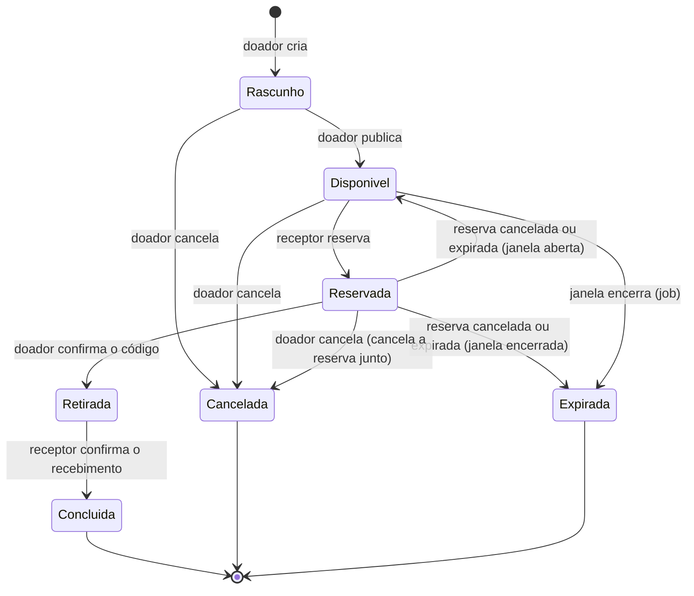
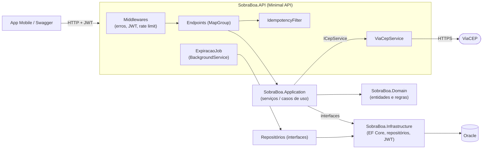

# SobraBoa API

API REST em **ASP.NET Core 10 (Minimal API)** que conecta **comércios com sobra de alimentos** a **organizações que atendem pessoas em insegurança alimentar**. Construída em Clean Architecture, com autenticação JWT por papéis, persistência em Oracle (EF Core), **idempotência sem condição de corrida**, **rate limiting por usuário**, health checks, **expiração automática de reservas**, documentação OpenAPI/Swagger e testes automatizados (unitários e de integração, padrão AAA).

> CitizenTech · FIAP Global Solution 2026/2 · Advanced Business Development with .NET
> ODS 2 (Fome Zero e Agricultura Sustentável) e ODS 12 (Consumo e Produção Responsáveis).
> Esta API é a mesma consumida pelo app da disciplina de Mobile.

## Sumário

1. [Visão geral](#1-visão-geral)
2. [O problema e a solução](#2-o-problema-e-a-solução)
3. [Domínio](#3-domínio)
4. [Arquitetura](#4-arquitetura)
5. [Autenticação e autorização (JWT)](#5-autenticação-e-autorização-jwt)
6. [Endpoints da API](#6-endpoints-da-api)
7. [Validações](#7-validações)
8. [Idempotência](#8-idempotência)
9. [Rate limiting](#9-rate-limiting)
10. [Expiração automática (job em segundo plano)](#10-expiração-automática-job-em-segundo-plano)
11. [Persistência (Oracle + EF Core)](#11-persistência-oracle--ef-core)
12. [Health checks e observabilidade](#12-health-checks-e-observabilidade)
13. [Configuração](#13-configuração)
14. [Como executar](#14-como-executar)
15. [Roteiro de demonstração](#15-roteiro-de-demonstração)
16. [Testes](#16-testes)
17. [Documentação da API (Swagger)](#17-documentação-da-api-swagger)
18. [Problemas conhecidos e correções aplicadas](#18-problemas-conhecidos-e-correções-aplicadas)
19. [Limitações e próximos passos](#19-limitações-e-próximos-passos)
20. [Boas práticas de segurança](#20-boas-práticas-de-segurança)
21. [Integrantes](#21-integrantes)

---

## 1. Visão geral

| Item | Tecnologia |
|---|---|
| Plataforma | .NET 10 / ASP.NET Core **Minimal APIs** |
| Banco de dados | Oracle via Entity Framework Core (migrations versionadas) |
| Autenticação | JWT Bearer, papéis `Doador`, `Receptor` e `Admin` |
| Documentação | Swagger/OpenAPI (`/swagger`) |
| Resiliência | Idempotência (`Idempotency-Key`) e Rate Limiting (`429`) |
| Tarefas em segundo plano | `BackgroundService` de expiração de reservas e doações |
| Integração externa | ViaCEP (validação de CEP no cadastro e health check) |
| Observabilidade | Serilog, Health Checks (`/health`) |
| Testes | xUnit, Moq, EF Core InMemory, `WebApplicationFactory` |
| Contêineres | Docker e Docker Compose |

## 2. O problema e a solução

Padarias, restaurantes e hortifrútis descartam alimento bom no fim do dia. Do outro lado, ONGs e abrigos precisam de alimento e não sabem onde, nem quando, há sobra. O SobraBoa faz a ponte:

1. O **doador** cadastra o que sobrou e a **janela de retirada** (ex.: das 17h às 21h) e publica a doação.
2. O **receptor** busca doações **perto dele** e **reserva** uma.
3. Na entrega, o receptor mostra um **código de retirada**; o doador confere e confirma.
4. O receptor confirma o recebimento e o sistema emite um **comprovante** com os quilos doados.
5. O **administrador** aprova os cadastros (só entidades verificadas participam) e acompanha as **métricas de impacto**.
6. Reservas que não são retiradas a tempo **expiram sozinhas** e a doação volta à vitrine enquanto a janela estiver aberta.

Cada mudança de status é gravada em uma **linha do tempo** (`HistoricoStatus`), que serve de trilha de auditoria. Mudanças feitas pelo sistema (como a expiração) aparecem sem autor.

## 3. Domínio

| Entidade | Descrição | Principais regras |
|---|---|---|
| `Usuario` | Doador, Receptor ou Admin | E-mail único e em minúsculas; senha com hash PBKDF2; cadastro nasce **Pendente**; cadastro público nunca cria Admin |
| `Doacao` | Sobra de alimentos de um doador | Janela deve terminar no futuro; ao menos 1 item; ciclo de vida validado dentro da entidade; expira quando a janela encerra |
| `ItemDoacao` | Item da doação | Quantidade > 0; peso ≥ 0 |
| `Reserva` | Reserva de uma doação por um receptor | Gera código de retirada de 6 caracteres; expira em 120 min ou no fim da janela; **retirada após `ExpiraEm` é recusada** |
| `Comprovante` | Prova da doação concluída | Um por reserva; guarda o peso total em kg |
| `HistoricoStatus` | Linha do tempo da doação | Registra status anterior/novo, autor (opcional) e data |
| `IdempotencyRecord` | Resposta gravada de uma requisição idempotente | Único por `(chave, escopo)`; `StatusCode = 0` significa "em processamento" |

### Papéis e permissões

| Papel | Pode | Não pode |
|---|---|---|
| **Doador** | Criar, editar, publicar e cancelar as **próprias** doações; confirmar retirada | Reservar doações |
| **Receptor** | Buscar por proximidade; reservar; confirmar recebimento; cancelar a própria reserva; listar as próprias reservas | Criar doações |
| **Admin** | Aprovar/rejeitar cadastros; ver métricas; ver qualquer comprovante e qualquer doação | — |

### Regras aplicadas além do papel

- Cadastro novo nasce **Pendente**: doador pendente não cria, edita nem publica doação, e receptor pendente não reserva (**403**).
- Só o **dono** mexe no que é dele (**403** caso contrário).
- **Rascunhos e doações canceladas só são visíveis ao dono e ao admin**; para os demais a API responde **404**, sem revelar que a doação existe.
- Doação que **exige refrigeração** só é reservada por receptor que **possui refrigeração** (**422**).
- Só pode haver **uma reserva em andamento por doação** (**409**): além da regra de domínio, um **índice único funcional** no Oracle é a barreira final contra reservas simultâneas.
- Reservar fora da janela de retirada é rejeitado (**422**).
- **Cancelar uma doação reservada cancela também a reserva ativa** (motivo "Doação cancelada pelo doador"), liberando o código de retirada e o índice único.
- Confirmar a retirada depois de `ExpiraEm` é rejeitado (**422**, "Reserva expirada").
- Editar uma doação exige título preenchido e janela que termina no futuro (**422**).

### Ciclo de vida



A **reserva** tem seus próprios estados: `Ativa` → `Retirada` → `Concluida`, ou `Ativa` → `Cancelada` / `Expirada`.

## 4. Arquitetura



**Regra de dependência:** `Domain` não depende de ninguém; `Application` depende só de `Domain`; `Infrastructure` implementa as interfaces da `Application`; `API` compõe tudo com injeção de dependência organizada por camada (`AddApplication()` e `AddInfrastructure()`). O cliente do ViaCEP fica na `API` porque `AddHttpClient` já faz parte do framework web.

**Fluxo de uma requisição:** Middleware (erros, autenticação, rate limit, autorização) → Endpoint → (filtro de idempotência) → Serviço (Application) → Entidade (regras) → Repositório (interface) → EF Core / Oracle.

### Camadas

| Camada | Projeto | Responsabilidade |
|---|---|---|
| Domínio | `SobraBoa.Domain` | Entidades com regras de negócio, enums e exceções de domínio |
| Aplicação | `SobraBoa.Application` | Serviços (casos de uso), DTOs com validação, interfaces de repositório, de segurança e de CEP |
| Infraestrutura | `SobraBoa.Infrastructure` | `DbContext`, Fluent API, migrations, repositórios, `UnitOfWork`, hash PBKDF2, gerador de JWT, store de idempotência |
| API | `SobraBoa.API` | Endpoints, filtros, `Program.cs`, JWT, Swagger, rate limiting, health checks, tratamento global de erros, job de expiração, cliente ViaCEP, `SecretsGuard` |
| Testes de Domínio | `SobraBoa.Domain.Tests` | Testes unitários das regras de negócio |
| Testes de Aplicação | `SobraBoa.Application.Tests` | Testes dos serviços e validadores com Moq |
| Testes de Integração | `SobraBoa.IntegrationTests` | Testes ponta a ponta com `WebApplicationFactory` |

### Estrutura de pastas

```
SobraBoa/
├── SobraBoa.slnx
├── docker-compose.yml
├── .env.example
├── src/
│   ├── SobraBoa.Domain/            Entities, Enums, Exceptions
│   ├── SobraBoa.Application/       Dtos (inclui CnpjAttribute), Interfaces (inclui ICepService), Services
│   ├── SobraBoa.Infrastructure/    Persistence, Repositories, Security, Idempotency, Migrations
│   └── SobraBoa.API/               Endpoints, Infrastructure (filtros, setups, ExpiracaoJob,
│                                   ViaCepService, SecretsGuard), Program.cs
└── tests/
    ├── SobraBoa.Domain.Tests/
    ├── SobraBoa.Application.Tests/
    └── SobraBoa.IntegrationTests/
```

### Decisões de design

| Decisão | Motivo |
|---|---|
| **Modelo de domínio rico** (métodos nas entidades) | A regra fica em um só lugar e não pode ser burlada; as invariantes valem sempre; os testes unitários dispensam mocks |
| **Minimal API** com `MapGroup` e *extension methods* | `Program.cs` enxuto e endpoints organizados por recurso |
| **`TimeProvider` injetado** | Permite testar janelas e expirações sem depender do relógio real |
| **Exceções de domínio mapeadas para HTTP** | Serviços e entidades não conhecem HTTP; o `IExceptionHandler` traduz |
| **Índice único funcional no Oracle** | Duas reservas simultâneas passam pelo `if` do código; o banco é a barreira final (**409**) |
| **Reservar a chave de idempotência antes de executar** | O índice único `(Chave, Escopo)` decide quem ganha a corrida entre requisições simultâneas |
| **Rate limiter depois da autenticação** | Só assim o limite global consegue particionar por usuário |
| **ViaCEP *fail-open*** | Falha de serviço de terceiros não derruba a API nem impede o cadastro; o health check mostra `Degraded` |
| **Job com escopo próprio por ciclo** | `DbContext` é *Scoped*; cada ciclo cria e descarta o seu |
| **`SecretsGuard` na subida** | Falhar cedo é melhor do que rodar com chave de exemplo |

## 5. Autenticação e autorização (JWT)

Fluxo: **registro → aprovação do admin → login → chamadas com Bearer**.

**1. Registrar** (aberto; nasce `Pendente`):

```bash
curl -X POST 'http://localhost:5080/api/auth/registro' \
  -H 'Content-Type: application/json' \
  -d '{
    "nome": "Rita Alves",
    "email": "padaria@exemplo.com",
    "senha": "Senha@123",
    "papel": "Doador",
    "nomeOrganizacao": "Padaria Boa Massa",
    "cnpj": "11.222.333/0001-81",
    "cep": "01310-100",
    "latitude": -23.5614,
    "longitude": -46.6559,
    "possuiRefrigeracao": false,
    "aceitouTermos": true
  }'
```

Para um receptor, use `"papel": "Receptor"` e `"possuiRefrigeracao": true` (se tiver). O CNPJ é validado pelos dígitos verificadores (o de exemplo acima é um CNPJ válido de teste) e o CEP é conferido no ViaCEP.

**2. Admin aprova** (faça login como admin e use o token dele):

```bash
curl -X PATCH 'http://localhost:5080/api/admin/usuarios/2/aprovacao' \
  -H "Authorization: Bearer $T_ADMIN" -H 'Content-Type: application/json' \
  -d '{"aprovado": true}'
```

**3. Login:**

```bash
curl -X POST 'http://localhost:5080/api/auth/login' \
  -H 'Content-Type: application/json' \
  -d '{"email":"padaria@exemplo.com","senha":"Senha@123"}'
```

```json
{
  "token": "eyJhbGciOiJIUzI1NiIs...",
  "tipo": "Bearer",
  "expiraEm": "2026-11-20T20:00:00Z",
  "usuarioId": 2,
  "nome": "Rita Alves",
  "papel": "Doador",
  "aprovacao": "Aprovado"
}
```

**4. Usar o token:** header `Authorization: Bearer <token>` (com o prefixo `Bearer` e um espaço, senão a API devolve `401`).

> **Pelo Swagger:** clique em **Authorize** e cole apenas o token retornado pelo login.

**Administrador inicial:** criado automaticamente na subida da API com `Admin:Email` e `Admin:Senha`, que vêm de *user-secrets* ou variável de ambiente (ver [seção 14](#14-como-executar)). O `appsettings.json` **não** traz mais senha de admin. Se `Admin:Senha` estiver vazia ou for o placeholder antigo (`TROCAR-VIA-SECRETS`), o admin **não é criado** e a API registra um aviso no log.

### Proteção contra segredos de exemplo (`SecretsGuard`)

Executado antes de qualquer outra coisa em `Program.cs`:

| Situação | Resultado |
|---|---|
| `Jwt:Key` ausente ou com menos de 32 caracteres | A API **não sobe** (qualquer ambiente) |
| `Jwt:Key` começa com `TROQUE-ESTA-CHAVE` fora de `Development` | A API **não sobe** |
| `Admin:Senha` ausente ou placeholder | A API sobe, mas **não cria o admin** (aviso no log) |

### Componentes

- `PasswordHasher` (Infrastructure): PBKDF2 (`Rfc2898DeriveBytes`, SHA-256, 100 mil iterações) com comparação em tempo constante.
- `JwtTokenGenerator` (Infrastructure): token HMAC-SHA256 com as claims `sub`, `email`, `name` e `role`.
- Validação do token: emissor, audiência, assinatura e expiração (tolerância de 30 s), com `MapInboundClaims = false` para manter `sub` e `role` como estão.
- Políticas de autorização `Doador`, `Receptor` e `Admin`, aplicadas por endpoint com `RequireAuthorization("...")`.
- O papel vai no token, mas a **aprovação do cadastro** é conferida pelos serviços a cada ação.
- Mensagem de login idêntica para e-mail inexistente e senha errada (não revela quais e-mails existem).

## 6. Endpoints da API

Todos os endpoints exigem `Authorization: Bearer {token}`, exceto `auth/*` e `health/*`. Todas as rotas `/api/*` podem responder **429** (ver [seção 9](#9-rate-limiting)).

| Método | Rota | Papel | Descrição | Códigos |
|---|---|---|---|---|
| POST | `/api/auth/registro` | público | Cadastra doador ou receptor (nasce Pendente) | 201, 400, 409, 422, 429 |
| POST | `/api/auth/login` | público | Autentica e devolve o JWT | 200, 400, 401, 429 |
| GET | `/api/admin/usuarios/pendentes` | Admin | Lista cadastros pendentes (paginado) | 200, 403 |
| PATCH | `/api/admin/usuarios/{id}/aprovacao` | Admin | Aprova ou rejeita (`{"aprovado": true}`) | 204, 404 |
| GET | `/api/admin/metricas` | Admin | kg doados, doações por status, aprovados | 200 |
| POST | `/api/doacoes` | Doador | Cria doação em **Rascunho** | 201, 400, 403, 422 |
| GET | `/api/doacoes/minhas` | Doador | Lista as próprias doações (paginado) | 200, 403 |
| GET | `/api/doacoes/proximas` | Receptor | Doações disponíveis num raio (km) | 200, 400, 403 |
| GET | `/api/doacoes/{id}` | autenticado | Detalha uma doação (rascunho e cancelada só para o dono ou admin) | 200, 401, 404 |
| PUT | `/api/doacoes/{id}` | Doador | Edita (só rascunho ou disponível) | 200, 400, 403, 404, 422 |
| PATCH | `/api/doacoes/{id}/publicar` | Doador | Publica (vai a Disponível) | 200, 403, 404, 422 |
| DELETE | `/api/doacoes/{id}` | Doador | Cancela a doação (e a reserva ativa, se houver) | 204, 403, 404, 422 |
| POST | `/api/doacoes/{id}/reservas` | Receptor | Reserva a doação — **idempotente** | 201, 400, 403, 409, 422 |
| GET | `/api/reservas/minhas` | Receptor | Lista as reservas do receptor (o código de retirada só aparece enquanto a reserva está `Ativa`) | 200, 403 |
| POST | `/api/reservas/{id}/retirada` | Doador | Confirma a retirada com o código | 200, 403, 404, 422 |
| POST | `/api/reservas/{id}/receber` | Receptor | Confirma recebimento e emite comprovante — **idempotente** | 200, 400, 403, 404, 409, 422 |
| POST | `/api/reservas/{id}/cancelar` | Receptor | Cancela a própria reserva | 204, 403, 404, 422 |
| GET | `/api/reservas/{id}/comprovante` | dono da reserva, dono da doação ou Admin | Consulta o comprovante | 200, 403, 404 |
| GET | `/health`, `/health/live`, `/health/ready` | público | Saúde da API e das dependências (fora do rate limit) | 200, 503 |

### Busca por proximidade

```bash
curl -H "Authorization: Bearer $T_RECEPTOR" \
  "http://localhost:5080/api/doacoes/proximas?lat=-23.5614&lng=-46.6559&raioKm=10&page=1&pageSize=10"
```

Retorna doações `Disponivel`, **dentro da janela de retirada e do raio** (`raioKm` até 50), ordenadas pelas que encerram primeiro, com a `distanciaKm` calculada (Haversine). Paginação: `page` (mínimo 1) e `pageSize` (1 a 50).

### Tratamento de erros (RFC 7807 / ProblemDetails)

| Exceção / situação | HTTP |
|---|---|
| Validação de DTO (DataAnnotations e `IValidatableObject`), JSON inválido, parâmetro fora do limite | 400 |
| `AuthenticationFailedException` (login inválido) / token ausente, inválido ou expirado | 401 |
| `ForbiddenException` / papel sem permissão / cadastro pendente | 403 |
| `NotFoundException` (inclui rascunho de outro doador) | 404 |
| `ConflictException` (reserva duplicada, e-mail já cadastrado) / chave de idempotência em processamento | 409 |
| `DomainException` (código errado, sem refrigeração, fora da janela, reserva expirada, CEP inexistente, papel Admin no cadastro) | 422 |
| Limite de requisições excedido | 429 |
| Qualquer outra | 500 (sem detalhes fora de Development) |

A resposta inclui `traceId` para correlação com os logs.

## 7. Validações

A validação automática (`AddValidation()`) roda **antes** do endpoint e devolve `400` com `ProblemDetails`. Regras que dependem do estado do sistema ficam no domínio e devolvem `422`.

**Cadastro (`RegistroRequest`)**

| Campo | Regra |
|---|---|
| `nome` | Obrigatório, até 120 caracteres |
| `email` | Obrigatório, formato de e-mail |
| `senha` | Obrigatória, mínimo de 8 caracteres |
| `papel` | `Doador` ou `Receptor` (`Admin` é recusado com 422) |
| `nomeOrganizacao` | Obrigatório, até 150 caracteres |
| `cnpj` | Opcional; se informado, valida os **dígitos verificadores** (`[Cnpj]`) |
| `cep` | Opcional; formato `01310-100` ou `01310100`. Se informado, é conferido no ViaCEP (inexistente = 422) |
| `latitude` / `longitude` | Entre -90 e 90 / entre -180 e 180 |
| `aceitouTermos` | Deve ser `true` |

**Doação (`DoacaoRequest`)**

| Campo | Regra |
|---|---|
| `titulo` | Obrigatório, até 150 caracteres |
| `janelaFim` | Deve ser **depois** de `janelaInicio` (400); no domínio, também deve estar no futuro (422) |
| `itens` | Ao menos 1 |
| `itens[].quantidade` | Entre 0,01 e 100000 |
| `itens[].pesoEstimadoKg` | Entre 0 e 100000 |

**Validação de CEP (ViaCEP):** a consulta tem timeout de 3 segundos. Se o ViaCEP estiver fora do ar ou lento, o cadastro **segue sem validar o CEP** (*fail-open*) e um aviso é registrado no log. Só um CEP que o ViaCEP confirma que não existe bloqueia o cadastro.

## 8. Idempotência

**Problema:** o receptor toca em "Reservar" numa rede ruim, o app não recebe a resposta e **reenvia**. Sem proteção, o servidor poderia duplicar a operação.

**Duas camadas de defesa:**

| Camada | Mecanismo | Protege contra |
|---|---|---|
| 1. **Chave de idempotência** | Header `Idempotency-Key` + tabela `SB_IDEMPOTENCIA` | O **mesmo cliente** reenviando a mesma requisição (inclusive simultaneamente): recebe **a resposta original** |
| 2. **Regras de domínio + índice único** | Status `Disponivel`→`Reservada` e `UQ_RESERVA_EM_ANDAMENTO` | **Clientes diferentes** disputando o mesmo recurso: o 2º recebe **409** |

Aplicada nos `POST` que criam efeito colateral: `/api/doacoes/{id}/reservas` e `/api/reservas/{id}/receber`. (`GET`, `PUT` e `DELETE` já são idempotentes por definição.)

### Fluxo do `IdempotencyFilter`

1. Header ausente ou com mais de 100 caracteres → **400**.
2. Já existe registro para `(chave, usuário + método + rota)`:
   - registro **concluído** → devolve a resposta gravada, com o header `Idempotent-Replayed: true`;
   - registro **em processamento** (`StatusCode = 0`) → **409** com `Retry-After: 1`.
3. **Reserva a chave** inserindo o registro antes de executar. O índice único `(Chave, Escopo)` decide a corrida: quem perde relê o registro do vencedor e responde como no passo 2.
4. Executa o endpoint. Se lançar exceção (409, 422, 403...), a chave é **liberada** e o cliente pode tentar de novo.
5. Respostas `< 500` são gravadas (`status + corpo`); erro de servidor (`>= 500`) libera a chave.

A chave é **escopada por usuário, método e rota**, então usuários diferentes podem usar a mesma string sem conflito. Registros com mais de 24 horas são removidos pelo job de expiração ([seção 10](#10-expiração-automática-job-em-segundo-plano)).

### Demonstração

```bash
KEY=$(uuidgen)
curl -X POST localhost:5080/api/doacoes/1/reservas -H "Authorization: Bearer $T" -H "Idempotency-Key: $KEY"  # 201, codigoRetirada K7M3QX
curl -X POST localhost:5080/api/doacoes/1/reservas -H "Authorization: Bearer $T" -H "Idempotency-Key: $KEY"  # 201 IDÊNTICO + Idempotent-Replayed: true
curl -X POST localhost:5080/api/doacoes/1/reservas -H "Authorization: Bearer $T"                              # 400 (sem a chave)
curl -X POST localhost:5080/api/doacoes/1/reservas -H "Authorization: Bearer $T2" -H "Idempotency-Key: outra" # 409 (outro receptor)
```

**Requisições simultâneas com a mesma chave** (precisa do Oracle real, pois o InMemory não impõe o índice único):

```bash
KEY=$(uuidgen)
seq 10 | xargs -P 10 -I{} curl -s -o /dev/null -w "%{http_code} " \
  -X POST localhost:5080/api/doacoes/1/reservas \
  -H "Authorization: Bearer $T" -H "Idempotency-Key: $KEY"; echo
# esperado: um 201 e os demais 201 (replay) ou 409 (em processamento); nunca duas reservas
```

```sql
SELECT COUNT(*) FROM SB_RESERVAS WHERE "DoacaoId" = 1 AND "Status" IN ('Ativa','Retirada'); -- 1
```

## 9. Rate limiting

Usa o middleware nativo `Microsoft.AspNetCore.RateLimiting` (sem pacote extra), com janela fixa (*fixed window*):

| Política | Escopo | Limite padrão | Objetivo |
|---|---|---|---|
| **Global** | Todas as rotas `/api/*`, **por usuário autenticado** (claim `sub`) ou por IP se anônimo | 100 req/min | Evitar uso excessivo |
| **`auth`** | `/api/auth/*`, por IP | **5 req/min** | Dificultar força bruta de senha |
| **Isentos** | `/health`, `/health/live`, `/health/ready` | sem limite | Monitoramento e health check do Docker não podem ser bloqueados |

**Ordem dos middlewares** (importa para o limite por usuário):

```
UseExceptionHandler → UseAuthentication → UseRateLimiter → UseAuthorization → endpoints
```

O limitador roda **depois** da autenticação para enxergar o `sub` do token e **antes** da autorização para também limitar quem tenta tokens inválidos em massa. Dois usuários atrás do mesmo IP (por exemplo, uma ONG inteira) têm cotas separadas.

Ao estourar: **HTTP 429** com header `Retry-After` e corpo `ProblemDetails`.

Os limites são configuráveis em `appsettings.json` (e sobrescritos nos testes de integração):

```json
"RateLimiting": {
  "Global": { "PermitLimit": 100, "WindowSeconds": 60 },
  "Auth":   { "PermitLimit": 5,   "WindowSeconds": 60 }
}
```

Demonstração:

```bash
for i in {1..7}; do curl -s -o /dev/null -w "%{http_code}\n" -X POST localhost:5080/api/auth/login \
  -H 'Content-Type: application/json' -d '{"email":"x@x.com","senha":"errada123"}'; done
# 401 401 401 401 401 429 429
```

## 10. Expiração automática (job em segundo plano)

O `ExpiracaoJob` (`BackgroundService` + `PeriodicTimer`) roda a cada 60 segundos, em escopo próprio, e faz três coisas:

1. **Reservas `Ativas` vencidas** (`ExpiraEm <= agora`) viram `Expirada`. Se a doação ainda está `Reservada`, ela volta a `Disponivel` quando a janela de retirada continua aberta, ou vira `Expirada` quando a janela já terminou.
2. **Doações `Disponiveis` com a janela encerrada** viram `Expirada`.
3. **Registros de idempotência com mais de 24 horas** são removidos.

Cada mudança de doação grava uma linha no `HistoricoStatus` sem autor ("Reserva expirada automaticamente", "Janela de retirada encerrada"). O processamento é em lotes de até 100 itens por ciclo, e uma falha em um ciclo é registrada no log sem derrubar a API.

Entre os ciclos, a regra do domínio continua valendo: tentar confirmar a retirada de uma reserva vencida é recusado com **422**, mesmo que o job ainda não tenha rodado.

```json
"Jobs": { "Expiracao": { "Habilitado": true, "IntervaloSegundos": 60 } }
```

Os testes de integração desligam o job (`Jobs:Expiracao:Habilitado = false`) para não interferir nos cenários.

## 11. Persistência (Oracle + EF Core)

- `SobraBoaContext` com Fluent API e migrations versionadas em `Infrastructure/Migrations` (aplicadas automaticamente na subida da API).
- Padrão **Repository** (`IUsuarioRepository`, `IDoacaoRepository`, `IReservaRepository`) e `UnitOfWork`, que traduz a violação de unicidade do Oracle (`ORA-00001`) em `ConflictException` (**409**).
- Enums gravados como **string**, o que deixa o banco legível e permite o índice abaixo.
- Paginação feita no banco (`Skip`/`Take`) com ordenação estável.
- Busca por proximidade em duas etapas: o banco filtra por "caixa" de coordenadas + status + janela; a **fórmula de Haversine** refina em memória.
- Consultas do job (reservas ativas vencidas, doações disponíveis vencidas) filtram e limitam no banco.

### Índice de reserva única (barreira final contra concorrência)

Adicionado manualmente na migration `InitialCreate`. Só "enxerga" reservas em andamento; quando a reserva termina o valor vira `NULL`, e o Oracle não indexa `NULL`:

```sql
CREATE UNIQUE INDEX UQ_RESERVA_EM_ANDAMENTO
ON SB_RESERVAS (CASE WHEN "Status" IN ('Ativa','Retirada') THEN "DoacaoId" END);
```

Por isso cancelar ou expirar uma reserva a tira do índice e libera a doação para uma nova reserva.

### Tabelas

`SB_USUARIOS`, `SB_DOACOES`, `SB_ITENS_DOACAO`, `SB_RESERVAS`, `SB_COMPROVANTES`, `SB_HISTORICO`, `SB_IDEMPOTENCIA`.

## 12. Health checks e observabilidade

`GET /health` retorna JSON detalhado (status geral, duração e detalhamento por check). HTTP `200` (Healthy/Degraded) ou `503` (Unhealthy). Também existem `GET /health/live` (apenas a API) e `GET /health/ready` (dependências). Os três ficam fora do rate limit.

| Check | Tags | Se falhar |
|---|---|---|
| `self` | live | Unhealthy |
| `oracle_database` | ready, db | **Unhealthy (503)**: sem banco, a API não funciona |
| `external_service` (ViaCEP) | ready, external | **Degraded (200)**: falha de terceiro não derruba a API |

O ViaCEP é um serviço que a API **realmente usa** (validação de CEP no cadastro), por isso é monitorado. Se ele cair, o `/health` mostra `Degraded` e o cadastro continua funcionando sem validar o CEP.

O check de serviço externo faz um `GET` com timeout de 3 segundos. URL e timeout são configuráveis:

```json
"HealthChecks": {
  "ExternalService": {
    "Url": "https://viacep.com.br/ws/01001000/json/",
    "TimeoutSeconds": 3
  }
}
```

**Logging estruturado:** Serilog com saída para console e arquivo (`logs/sobraboa-api-.log`, rotação diária, 14 arquivos) e `CorrelationId` por requisição.

## 13. Configuração

| Chave | Padrão | Descrição |
|---|---|---|
| `ConnectionStrings:OracleConnection` | — | Conexão com o Oracle (user-secrets ou variável de ambiente) |
| `Jwt:Key` | placeholder (só `Development`) | Chave de assinatura, **mínimo de 32 caracteres** |
| `Jwt:Issuer` / `Jwt:Audience` | `SobraBoa.API` / `SobraBoa.Clients` | Emissor e audiência do token |
| `Jwt:ExpiresInMinutes` | `120` | Validade do token |
| `Admin:Email` | `admin@sobraboa.com` | E-mail do administrador inicial |
| `Admin:Senha` | — (sem padrão) | Senha do administrador inicial; sem ela o admin não é criado |
| `RateLimiting:Global` | `100` / `60 s` | Limite global por usuário ou IP |
| `RateLimiting:Auth` | `5` / `60 s` | Limite de `/api/auth/*` por IP |
| `HealthChecks:ExternalService` | ViaCEP / `3 s` | URL e timeout do check externo |
| `Jobs:Expiracao:Habilitado` | `true` | Liga ou desliga o job de expiração |
| `Jobs:Expiracao:IntervaloSegundos` | `60` | Intervalo entre ciclos do job |
| `Seed:DadosDemo` | `false` | Cria usuários e doações de demonstração (**nunca em produção**) |

Variáveis de ambiente usam `__` no lugar de `:` (ex.: `Jwt__Key`, `Admin__Senha`).

## 14. Como executar

### Opção rápida: tudo em Docker (recomendada)

Pré-requisito: Docker. Nenhum Oracle ou .NET instalado.

```bash
cp .env.example .env        # edite os valores (senhas e JWT_KEY com 32+ caracteres)
docker compose up -d --build
docker compose logs -f api  # a 1ª subida do Oracle leva alguns minutos
```

As migrations são aplicadas e o administrador é criado automaticamente na subida da API.

| Serviço | URL |
|---|---|
| Swagger | http://localhost:5080/swagger |
| Health check | http://localhost:5080/health |

Para parar e apagar os dados: `docker compose down -v`.

> Variáveis do `.env`: `ORACLE_PASSWORD`, `ORACLE_APP_PASSWORD`, `JWT_KEY`, `ADMIN_SENHA`. Use apenas letras e números nas senhas do Oracle (símbolos quebram a connection string).
> Se `JWT_KEY` ficar vazia ou curta, a API **recusa subir** (`SecretsGuard`).
> O `docker-compose.yml` sobe com `ASPNETCORE_ENVIRONMENT=Development` e `Seed__DadosDemo=true` para habilitar o Swagger e os dados de demonstração. **Não use essa configuração em produção.**

### Opção manual (API local)

Pré-requisitos: **.NET 10 SDK** e um banco Oracle acessível (local ou remoto).

```bash
# 1) segredos (nunca commitar credenciais)
cd src/SobraBoa.API
dotnet user-secrets init
dotnet user-secrets set "ConnectionStrings:OracleConnection" "User Id=SEU_USUARIO;Password=SUA_SENHA;Data Source=SEU_HOST:1521/SEU_SERVICE"
dotnet user-secrets set "Jwt:Key" "UMA-CHAVE-ALEATORIA-COM-MAIS-DE-32-CARACTERES"
dotnet user-secrets set "Admin:Email" "admin@sobraboa.com"
dotnet user-secrets set "Admin:Senha" "SUA_SENHA_ADMIN"
cd ../..

# 2) restaurar, migrar e executar
dotnet restore
dotnet tool install --global dotnet-ef          # se ainda não tiver
dotnet ef database update --project src/SobraBoa.Infrastructure --startup-project src/SobraBoa.API
dotnet run --project src/SobraBoa.API
```

A URL de escuta aparece no console. Em `Development`, a chave de exemplo do `appsettings.json` ainda é aceita (precisa ter 32+ caracteres), mas **fora de `Development` a API se recusa a subir com ela**.

Para criar uma nova migration no futuro:

```bash
dotnet ef migrations add NomeDaMigration --project src/SobraBoa.Infrastructure --startup-project src/SobraBoa.API
```

### Roteiro rápido de teste (3 comandos)

```bash
API=http://localhost:5080
# 1) login do admin
curl -X POST $API/api/auth/login -H 'Content-Type: application/json' -d '{"email":"admin@sobraboa.com","senha":"SUA_SENHA_ADMIN"}'
# 2) copie o "token" e liste os cadastros pendentes
curl $API/api/admin/usuarios/pendentes -H "Authorization: Bearer SEU_TOKEN"
# 3) veja a saúde da API
curl $API/health
```

## 15. Roteiro de demonstração

Com `Seed__DadosDemo=true` (Docker Compose), a API sobe com dados prontos. **Senha de todos: `Senha@123`.**

| Usuário (`@sobraboa.com`) | Papel | Situação |
|---|---|---|
| `padaria` | Doador | Aprovado |
| `restaurante` | Doador | Aprovado |
| `hortifruti` | Doador | **Pendente** (testa o 403) |
| `ong` | Receptor | Aprovado, **com** refrigeração |
| `casa` | Receptor | Aprovado, **sem** refrigeração (testa o 422) |
| `abrigo` | Receptor | **Pendente** (testa o 403) |

Doações criadas: pães do dia (disponível), bolos e tortas (rascunho), marmitas refrigeradas (disponível, exige refrigeração), sanduíches naturais (**reservada** pela `ong`, com código de retirada no log) e sopa do dia (**concluída**, com comprovante, já alimentando as métricas).

Sugestão de ordem para apresentar:

1. **Swagger** (`/swagger`): mostrar os grupos, o botão *Authorize* e o header `Idempotency-Key` documentado.
2. **Autenticação e papéis:** login como `padaria`, tentar `GET /api/doacoes/proximas` (403, rota de receptor).
3. **Aprovação:** login como admin, listar pendentes, aprovar o `hortifruti` e ver `GET /api/admin/metricas`.
4. **Busca por proximidade:** login como `ong`, `GET /api/doacoes/proximas`.
5. **Regra de refrigeração:** `casa` tenta reservar as marmitas (422); `ong` consegue.
6. **Idempotência:** reservar duas vezes com a mesma `Idempotency-Key` (mesma resposta e `Idempotent-Replayed: true`) e, depois, com outro receptor (409).
7. **Fluxo completo:** retirada com o código → recebimento → `GET /api/reservas/{id}/comprovante`.
8. **Visibilidade:** a `ong` consulta o rascunho de bolos (404); a `padaria` consulta o mesmo rascunho (200).
9. **Rate limiting:** o laço de login da [seção 9](#9-rate-limiting) (401 ... 429).
10. **Health checks:** `GET /health` e, se possível, mostrar o `Degraded` com o ViaCEP bloqueado.
11. **Expiração:** mostrar o `HistoricoStatus` e o log do `ExpiracaoJob`.

## 16. Testes

```bash
dotnet test                                    # todos os projetos
dotnet test tests/SobraBoa.Domain.Tests        # por camada
dotnet test tests/SobraBoa.Application.Tests
dotnet test tests/SobraBoa.IntegrationTests

dotnet test --logger "console;verbosity=normal" > resultado-testes.txt   # gera o relatório de entrega
dotnet test --collect:"XPlat Code Coverage"                              # cobertura (coverlet)
```

- **Domain.Tests**: regras de negócio das entidades (janela, ciclo de vida, código de retirada, expiração de reserva e doação, cancelamento, edição), sem mocks, padrão AAA.
- **Application.Tests**: serviços com repositórios mockados (Moq):
  - `ReservaService`: papel, aprovação, dono do recurso e refrigeração;
  - `DoacaoService`: busca por proximidade e Haversine, visibilidade de rascunhos, cancelamento em cascata;
  - `AuthService`: e-mail duplicado, CEP inexistente, ViaCEP indisponível, login válido e inválido;
  - `AdminService`: aprovação, rejeição e paginação;
  - `CnpjAttribute`: dígitos verificadores.
- **IntegrationTests**: fluxo HTTP completo via `WebApplicationFactory<Program>`, com o Oracle substituído por InMemory e a autenticação JWT **real** (token gerado com a mesma chave do `appsettings.json`). Cobrem:
  - `401` sem token, `403` com papel errado ou doação de outro doador, `400` em validação (CNPJ, CEP, janela, termos, itens), `422` para papel Admin no cadastro e para refrigeração;
  - **idempotência** (mesma `Idempotency-Key` devolve a mesma resposta, sem `409`, em `/reservas` e em `/receber`);
  - `409` para outro receptor na mesma doação;
  - **rate limiting** (`429` com `Retry-After`);
  - **health checks** (ViaCEP fora do ar retorna `200` com `Degraded`);
  - **visibilidade** (`404` para rascunho de outro usuário) e cancelamento da doação encerrando a reserva;
  - `GET /api/reservas/minhas` listando só as reservas do receptor autenticado;
  - fluxo completo: reservar → retirar → receber → comprovante.

O resultado da última execução fica em `resultado-testes.txt` (gere com o comando acima antes da entrega).

### Compartilhamento de fixture (`ICollectionFixture`)

As classes de integração compartilham uma única `CustomWebApplicationFactory` (e o mesmo banco InMemory) por uma coleção xUnit. Como o banco é compartilhado, os dados de teste usam `Guid.NewGuid()` em campos únicos (e-mail) para evitar colisões. A fábrica também desliga o job de expiração e aponta o ViaCEP do health check para um endereço inexistente.

```csharp
[CollectionDefinition("IntegrationTests")]
public class IntegrationTestsCollection : ICollectionFixture<CustomWebApplicationFactory> { }
```

> **Limitação:** o provider InMemory **não aplica** o índice único funcional do Oracle, e por isso não reproduz a corrida de idempotência nem a barreira final de reserva única. Esses comportamentos são cobertos pelas regras de domínio (testadas) e pela verificação manual com o Oracle real (ver [seção 8](#8-idempotência)).

## 17. Documentação da API (Swagger)

- Swagger UI em `/swagger` (ambiente Development), com resumo, contratos de entrada/saída, códigos de resposta e esquema **Bearer** (botão Authorize aceita só o token).
- Todos os endpoints têm `WithSummary` e as respostas de erro principais (400, 401, 403, 404, 409, 422).
- O **429** está documentado nos grupos de endpoints.
- O header `Idempotency-Key` (obrigatório) aparece documentado nos endpoints idempotentes.

## 18. Problemas conhecidos e correções aplicadas

### Durante o desenvolvimento

| Problema | Causa | Correção |
|---|---|---|
| `NU1202`: pacote 11.0.0 não é compatível com `net10.0` | `dotnet add package` sem versão traz a mais recente (versão 11) | Fixar a linha 10 dos pacotes Microsoft/EF: `--version "10.*"` |
| `Your startup project doesn't reference Microsoft.EntityFrameworkCore.Design` | Pacote ausente no projeto de inicialização (API) | Instalar `Microsoft.EntityFrameworkCore.Design` na API |
| `Unable to create a 'DbContext'` ao gerar migration | `Program.cs` ainda sem `AddInfrastructure(...)` (template) | Registrar `AddApplication()` e `AddInfrastructure(configuration)` |
| `ORA-00904: "FALSE": invalid identifier` com `AnyAsync()` | Provider Oracle gera literais `TRUE/FALSE` não suportados | Usar `CountAsync(...) > 0` nas verificações de existência |
| Teste de integração retornava `500` no registro | Enums enviados como texto (`"Doador"`) sem conversor JSON | `JsonStringEnumConverter` em `ConfigureHttpJsonOptions` |
| `BadHttpRequestException` virava `500` | O handler global não tratava erro de binding | Mapear `BadHttpRequestException` para o status da própria exceção (`400`) |
| Admin recebia `403` mesmo com token válido | O JwtBearer renomeia claims (`role`, `sub`) por padrão | `MapInboundClaims = false` no `AddJwtBearer` |
| Rotas protegidas retornando `401` mesmo com token | Ordem errada dos middlewares | `UseAuthentication()` **antes** de `UseAuthorization()` |
| `AddDbContextCheck` não resolvia | Pacote de health checks do EF só na Infrastructure | Instalar `Microsoft.Extensions.Diagnostics.HealthChecks.EntityFrameworkCore` (10.x) na API |
| Solution criada como `.slnx` | O SDK do .NET 10 gera `.slnx` por padrão | Usar `SobraBoa.slnx` nos comandos e commits |
| Gravação lenta se serviço externo cair | Timeout padrão do `HttpClient` é longo | Timeout de 3 s no health check do ViaCEP (resultado `Degraded`) |

### Correções da revisão

| Problema | Causa | Correção |
|---|---|---|
| API subia com admin de senha conhecida e chave JWT de exemplo | `Admin:Senha` e `Jwt:Key` placeholder no `appsettings.json` eram valores válidos | `SecretsGuard` (recusa chave curta ou de exemplo fora de `Development`), remoção da senha do `appsettings.json` e do seed do admin com placeholder |
| Rate limit "por usuário" agrupava todos por IP | `UseRateLimiter()` rodava antes de `UseAuthentication()`, então `HttpContext.User` ainda estava vazio | Ordem `UseAuthentication` → `UseRateLimiter` → `UseAuthorization`; partição pela claim `sub` sem `int.Parse`; `/health` isento |
| Qualquer usuário lia rascunhos de outros doadores | `GET /api/doacoes/{id}` não conferia dono nem status | Rascunho e cancelada só para dono ou admin (404 para os demais) |
| Reserva continuava `Ativa` após cancelar a doação | O cancelamento só mudava a doação | `CancelarAsync` cancela também a reserva ativa |
| Mesma chave simultânea executava o endpoint duas vezes | O filtro fazia consulta → execução → gravação | Reserva da chave **antes** de executar, com estado "em processamento" (409 + `Retry-After`) e liberação da chave em caso de falha |
| Reservas nunca expiravam | `ExpiraEm` era gravado e não verificado | Verificação na retirada (422) e `ExpiracaoJob` |
| Health check do ViaCEP sem uso real | A API só guardava o CEP como texto | Validação do CEP no cadastro, *fail-open* |
| `GET /api/reservas/minhas` inexistente | `ListarDoReceptorAsync` existia, mas sem endpoint | Endpoint exposto para o receptor |
| Janela inválida e CNPJ livre no cadastro | Validação só no domínio (422) ou ausente | `IValidatableObject` na doação (400), `[Cnpj]` e formato do CEP |

## 19. Limitações e próximos passos

- **Idempotência não compara o corpo** da requisição com o original (o padrão IETF recomenda rejeitar a mesma chave com payload diferente). Os dois endpoints idempotentes atuais não têm corpo, então o impacto é nulo hoje. O *replay* também não repete o header `Location` do `201`.
- **Expiração com atraso de até um ciclo do job** (60 s por padrão). A retirada de reserva vencida já é recusada pela regra do domínio, mesmo antes do job rodar.
- **Rate limit em memória:** não é compartilhado entre várias instâncias da API (para isso, usar Redis).
- **ViaCEP *fail-open*:** com o serviço fora do ar, o cadastro aceita qualquer CEP de formato válido.
- **`GET /api/reservas/minhas` sem paginação:** devolve todas as reservas do receptor.
- **Sem refresh token:** o JWT expira em 120 minutos.
- **Comprovante sem PDF**: apenas os dados; a emissão do arquivo é uma evolução (por exemplo, com QuestPDF).
- **Sem notificações:** mensageria (e-mail/push) para avisar doador e receptor é uma extensão natural, inclusive para avisar sobre reservas que expiram.
- **Teste do índice único com Oracle real:** hoje é manual; o próximo passo é automatizar com Testcontainers.
- **Integração contínua:** um workflow do GitHub Actions rodando `dotnet build` e `dotnet test` a cada push.
- **Dependência transitiva com aviso de vulnerabilidade** (`System.Security.Cryptography.Pkcs`, avisos `NU1902/NU1903`) vinda do provider Oracle; atualizar antes de produção.

## 20. Boas práticas de segurança

- **Nunca** commitar a `Jwt:Key` real, senhas do banco ou o `.env` (já está no `.gitignore`); usar *user-secrets*, variáveis de ambiente ou um cofre de segredos.
- A API **recusa subir** com `Jwt:Key` curta (menos de 32 caracteres) ou com a chave de exemplo fora de `Development`, e **não cria o admin** com senha placeholder.
- Trocar a chave de exemplo do `appsettings.json` antes de qualquer deploy.
- Senhas com PBKDF2 e comparação em tempo constante; resposta de login que não revela se o e-mail existe.
- Rate limit estrito em login/registro contra força bruta, e limite global por usuário.
- Rascunhos e doações canceladas respondem 404 a quem não é dono, sem revelar que existem.
- Cadastro público não cria `Admin`; a aprovação é conferida a cada ação, não só no login.
- Erros nunca expõem *stack trace* fora de Development.
- Dados de demonstração (`Seed__DadosDemo`) e o ambiente `Development` do Docker Compose são **só para demonstração**.
- Considerar refresh tokens e expiração mais curta do access token em produção.

## 21. Integrantes

| Nome | RM |
|---|---|
| Felipe Kirschner Modesto | RM561810 |
| João Victor Luiz Oliveira Resende | RM565139 |
| Pedro Vaz Ferreira | RM566551 |
| Vitor Dias dos Santos | RM565422 |
