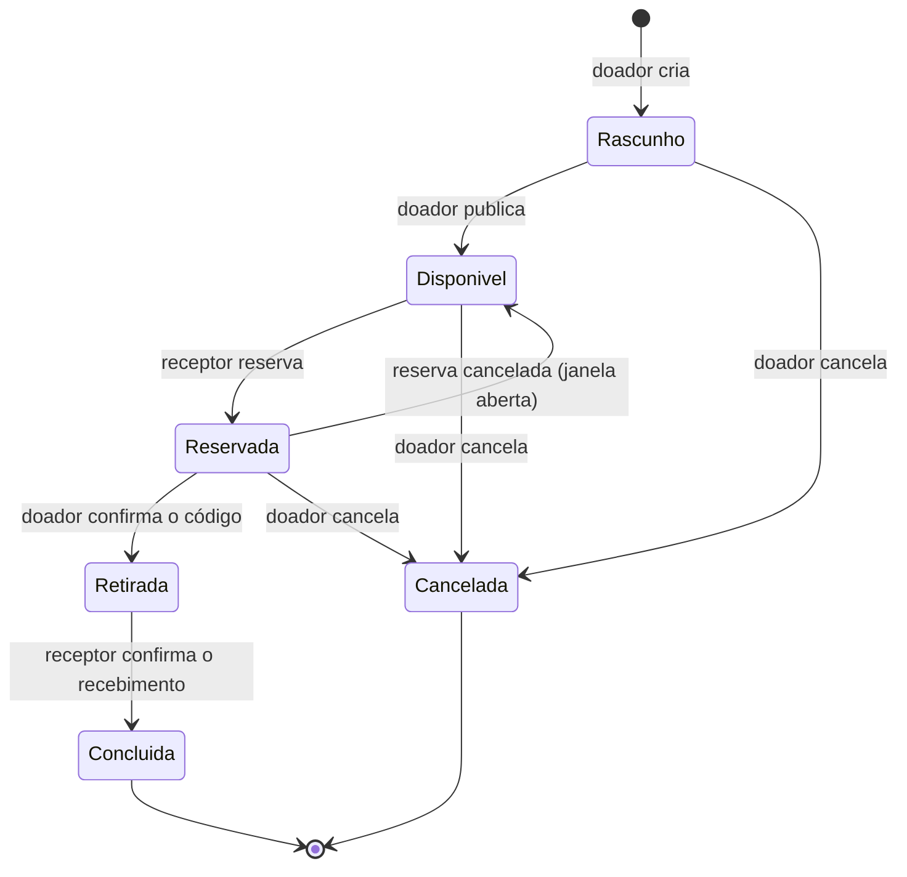
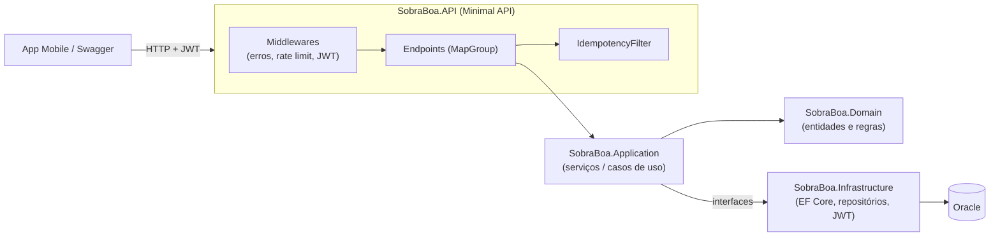

# SobraBoa API

API REST em **ASP.NET Core 10 (Minimal API)** que conecta **comércios com sobra de alimentos** a **organizações que atendem pessoas em insegurança alimentar**. Construída em Clean Architecture, com autenticação JWT por papéis, persistência em Oracle (EF Core), **idempotência**, **rate limiting**, health checks, documentação OpenAPI/Swagger e testes automatizados (unitários e de integração, padrão AAA).

> CitizenTech · FIAP Global Solution 2026/2 · Advanced Business Development with .NET
> ODS 2 (Fome Zero e Agricultura Sustentável) e ODS 12 (Consumo e Produção Responsáveis).
> Esta API é a mesma consumida pelo app da disciplina de Mobile.

## Sumário

1. [Visão geral](#1-visão-geral)
2. [O problema e a solução](#2-o-problema-e-a-solução)
3. [Domínio](#3-domínio)
4. [Arquitetura](#4-arquitetura)
5. [Autenticação e autorização (JWT)](#5-autenticação-e-autorização-jwt)
6. [Endpoints da API](#6-endpoints-da-api)
7. [Idempotência](#7-idempotência)
8. [Rate limiting](#8-rate-limiting)
9. [Persistência (Oracle + EF Core)](#9-persistência-oracle--ef-core)
10. [Health checks e observabilidade](#10-health-checks-e-observabilidade)
11. [Como executar](#11-como-executar)
12. [Testes](#12-testes)
13. [Documentação da API (Swagger)](#13-documentação-da-api-swagger)
14. [Problemas conhecidos e correções aplicadas](#14-problemas-conhecidos-e-correções-aplicadas)
15. [Limitações e próximos passos](#15-limitações-e-próximos-passos)
16. [Boas práticas de segurança](#16-boas-práticas-de-segurança)
17. [Integrantes](#17-integrantes)

---

## 1. Visão geral

| Item | Tecnologia |
|---|---|
| Plataforma | .NET 10 / ASP.NET Core **Minimal APIs** |
| Banco de dados | Oracle via Entity Framework Core (migrations versionadas) |
| Autenticação | JWT Bearer, papéis `Doador`, `Receptor` e `Admin` |
| Documentação | Swagger/OpenAPI (`/swagger`) |
| Resiliência | Idempotência (`Idempotency-Key`) e Rate Limiting (`429`) |
| Observabilidade | Serilog, Health Checks (`/health`) |
| Testes | xUnit, Moq, EF Core InMemory, `WebApplicationFactory` |
| Contêineres | Docker e Docker Compose |

## 2. O problema e a solução

Padarias, restaurantes e hortifrútis descartam alimento bom no fim do dia. Do outro lado, ONGs e abrigos precisam de alimento e não sabem onde, nem quando, há sobra. O SobraBoa faz a ponte:

1. O **doador** cadastra o que sobrou e a **janela de retirada** (ex.: das 17h às 21h) e publica a doação.
2. O **receptor** busca doações **perto dele** e **reserva** uma.
3. Na entrega, o receptor mostra um **código de retirada**; o doador confere e confirma.
4. O receptor confirma o recebimento e o sistema emite um **comprovante** com os quilos doados.
5. O **administrador** aprova os cadastros (só entidades verificadas participam) e acompanha as **métricas de impacto**.

Cada mudança de status é gravada em uma **linha do tempo** (`HistoricoStatus`), que serve de trilha de auditoria.

## 3. Domínio

| Entidade | Descrição | Principais regras |
|---|---|---|
| `Usuario` | Doador, Receptor ou Admin | E-mail único e em minúsculas; senha com hash PBKDF2; cadastro nasce **Pendente** |
| `Doacao` | Sobra de alimentos de um doador | Janela deve terminar no futuro; ao menos 1 item; ciclo de vida validado dentro da entidade |
| `ItemDoacao` | Item da doação | Quantidade > 0; peso ≥ 0 |
| `Reserva` | Reserva de uma doação por um receptor | Gera código de retirada de 6 caracteres; expira em 120 min ou no fim da janela |
| `Comprovante` | Prova da doação concluída | Um por reserva; guarda o peso total em kg |
| `HistoricoStatus` | Linha do tempo da doação | Registra status anterior/novo, autor e data |
| `IdempotencyRecord` | Resposta gravada de uma requisição idempotente | Único por `(chave, escopo)` |

### Papéis e permissões

| Papel | Pode | Não pode |
|---|---|---|
| **Doador** | Criar, editar, publicar e cancelar as **próprias** doações; confirmar retirada | Reservar doações |
| **Receptor** | Buscar por proximidade; reservar; confirmar recebimento; cancelar a própria reserva | Criar doações |
| **Admin** | Aprovar/rejeitar cadastros; ver métricas; ver qualquer comprovante | — |

### Regras aplicadas além do papel

- Cadastro novo nasce **Pendente**: doador pendente não cria doação e receptor pendente não reserva (**403**).
- Só o **dono** mexe no que é dele (**403** caso contrário).
- Doação que **exige refrigeração** só é reservada por receptor que **possui refrigeração** (**422**).
- Só pode haver **uma reserva em andamento por doação** (**409**): além da regra de domínio, um **índice único funcional** no Oracle é a barreira final contra reservas simultâneas.
- Reservar fora da janela de retirada é rejeitado (**422**).

### Ciclo de vida



A **reserva** tem seus próprios estados: `Ativa` → `Retirada` → `Concluida`, ou `Cancelada` / `Expirada`.

## 4. Arquitetura



**Regra de dependência:** `Domain` não depende de ninguém; `Application` depende só de `Domain`; `Infrastructure` implementa as interfaces da `Application`; `API` compõe tudo com injeção de dependência organizada por camada (`AddApplication()` e `AddInfrastructure()`).

**Fluxo de uma requisição:** Middleware → Endpoint → (filtro de idempotência) → Serviço (Application) → Entidade (regras) → Repositório (interface) → EF Core / Oracle.

### Camadas

| Camada | Projeto | Responsabilidade |
|---|---|---|
| Domínio | `SobraBoa.Domain` | Entidades com regras de negócio, enums e exceções de domínio |
| Aplicação | `SobraBoa.Application` | Serviços (casos de uso), DTOs com validação, interfaces de repositório e de segurança |
| Infraestrutura | `SobraBoa.Infrastructure` | `DbContext`, Fluent API, migrations, repositórios, `UnitOfWork`, hash PBKDF2, gerador de JWT, store de idempotência |
| API | `SobraBoa.API` | Endpoints, filtros, `Program.cs`, JWT, Swagger, rate limiting, health checks, tratamento global de erros |
| Testes de Domínio | `SobraBoa.Domain.Tests` | Testes unitários das regras de negócio |
| Testes de Aplicação | `SobraBoa.Application.Tests` | Testes dos serviços com Moq |
| Testes de Integração | `SobraBoa.IntegrationTests` | Testes ponta a ponta com `WebApplicationFactory` |

### Estrutura de pastas

```
SobraBoa/
├── SobraBoa.slnx
├── docker-compose.yml
├── .env.example
├── src/
│   ├── SobraBoa.Domain/            Entities, Enums, Exceptions
│   ├── SobraBoa.Application/       Dtos, Interfaces, Services
│   ├── SobraBoa.Infrastructure/    Persistence, Repositories, Security, Idempotency, Migrations
│   └── SobraBoa.API/               Endpoints, Infrastructure (filtros, setups), Program.cs
└── tests/
    ├── SobraBoa.Domain.Tests/
    ├── SobraBoa.Application.Tests/
    └── SobraBoa.IntegrationTests/
```

### Decisões de design

| Decisão | Motivo |
|---|---|
| **Modelo de domínio rico** (métodos nas entidades) | A regra fica em um só lugar e não pode ser burlada; as invariantes valem sempre; os testes unitários dispensam mocks |
| **Minimal API** com `MapGroup` e *extension methods* | `Program.cs` enxuto e endpoints organizados por recurso |
| **`TimeProvider` injetado** | Permite testar janelas e expirações sem depender do relógio real |
| **Exceções de domínio mapeadas para HTTP** | Serviços e entidades não conhecem HTTP; o `IExceptionHandler` traduz |
| **Índice único funcional no Oracle** | Duas reservas simultâneas passam pelo `if` do código; o banco é a barreira final (**409**) |
| **ViaCEP como `Degraded`** | Falha de serviço de terceiros não deve derrubar a API |

## 5. Autenticação e autorização (JWT)

Fluxo: **registro → aprovação do admin → login → chamadas com Bearer**.

**1. Registrar** (aberto; nasce `Pendente`):

```bash
curl -X POST 'http://localhost:5080/api/auth/registro' \
  -H 'Content-Type: application/json' \
  -d '{
    "nome": "Rita Alves",
    "email": "padaria@exemplo.com",
    "senha": "Senha@123",
    "papel": "Doador",
    "nomeOrganizacao": "Padaria Boa Massa",
    "cnpj": "11.111.111/0001-11",
    "cep": "01310-100",
    "latitude": -23.5614,
    "longitude": -46.6559,
    "possuiRefrigeracao": false,
    "aceitouTermos": true
  }'
```

Para um receptor, use `"papel": "Receptor"` e `"possuiRefrigeracao": true` (se tiver).

**2. Admin aprova** (faça login como admin e use o token dele):

```bash
curl -X PATCH 'http://localhost:5080/api/admin/usuarios/2/aprovacao' \
  -H "Authorization: Bearer $T_ADMIN" -H 'Content-Type: application/json' \
  -d '{"aprovado": true}'
```

**3. Login:**

```bash
curl -X POST 'http://localhost:5080/api/auth/login' \
  -H 'Content-Type: application/json' \
  -d '{"email":"padaria@exemplo.com","senha":"Senha@123"}'
```

```json
{
  "token": "eyJhbGciOiJIUzI1NiIs...",
  "tipo": "Bearer",
  "expiraEm": "2026-11-20T20:00:00Z",
  "usuarioId": 2,
  "nome": "Rita Alves",
  "papel": "Doador",
  "aprovacao": "Aprovado"
}
```

**4. Usar o token:** header `Authorization: Bearer <token>` (com o prefixo `Bearer` e um espaço, senão a API devolve `401`).

> **Pelo Swagger:** clique em **Authorize** e cole apenas o token retornado pelo login.

**Administrador inicial:** criado automaticamente na subida da API com `Admin:Email` e `Admin:Senha` (configuração/variável de ambiente, ver [seção 11](#11-como-executar)).

### Configuração (`appsettings.json`)

```json
"Jwt": {
  "Key": "TROQUE-ESTA-CHAVE-SUPER-SECRETA-COM-NO-MINIMO-32-CARACTERES",
  "Issuer": "SobraBoa.API",
  "Audience": "SobraBoa.Clients",
  "ExpiresInMinutes": "120"
}
```

### Componentes

- `PasswordHasher` (Infrastructure): PBKDF2 (`Rfc2898DeriveBytes`, SHA-256, 100 mil iterações) com comparação em tempo constante.
- `JwtTokenGenerator` (Infrastructure): token HMAC-SHA256 com as claims `sub`, `email`, `name` e `role`.
- Políticas de autorização `Doador`, `Receptor` e `Admin`, aplicadas por endpoint com `RequireAuthorization("...")`.
- Mensagem de login idêntica para e-mail inexistente e senha errada (não revela quais e-mails existem).

## 6. Endpoints da API

Todos os endpoints exigem `Authorization: Bearer {token}`, exceto `auth/*` e `health/*`.

| Método | Rota | Papel | Descrição | Códigos |
|---|---|---|---|---|
| POST | `/api/auth/registro` | público | Cadastra doador ou receptor (nasce Pendente) | 201, 400, 409, 429 |
| POST | `/api/auth/login` | público | Autentica e devolve o JWT | 200, 401, 429 |
| GET | `/api/admin/usuarios/pendentes` | Admin | Lista cadastros pendentes (paginado) | 200, 403 |
| PATCH | `/api/admin/usuarios/{id}/aprovacao` | Admin | Aprova ou rejeita (`{"aprovado": true}`) | 204, 404 |
| GET | `/api/admin/metricas` | Admin | kg doados, doações por status, aprovados | 200 |
| POST | `/api/doacoes` | Doador | Cria doação em **Rascunho** | 201, 400, 403, 422 |
| GET | `/api/doacoes/minhas` | Doador | Lista as próprias doações (paginado) | 200 |
| GET | `/api/doacoes/proximas` | Receptor | Doações disponíveis num raio (km) | 200, 400, 403 |
| GET | `/api/doacoes/{id}` | autenticado | Detalha uma doação | 200, 404 |
| PUT | `/api/doacoes/{id}` | Doador | Edita (só rascunho ou disponível) | 200, 403, 422 |
| PATCH | `/api/doacoes/{id}/publicar` | Doador | Publica (vai a Disponível) | 200, 422 |
| DELETE | `/api/doacoes/{id}` | Doador | Cancela a doação | 204, 403, 422 |
| POST | `/api/doacoes/{id}/reservas` | Receptor | Reserva a doação — **idempotente** | 201, 400, 403, 409, 422 |
| POST | `/api/reservas/{id}/retirada` | Doador | Confirma a retirada com o código | 200, 403, 422 |
| POST | `/api/reservas/{id}/receber` | Receptor | Confirma recebimento e emite comprovante — **idempotente** | 200, 403, 422 |
| POST | `/api/reservas/{id}/cancelar` | Receptor | Cancela a própria reserva | 204, 403, 422 |
| GET | `/api/reservas/{id}/comprovante` | dono / Admin | Consulta o comprovante | 200, 403, 404 |
| GET | `/health`, `/health/live`, `/health/ready` | público | Saúde da API e das dependências | 200, 503 |

### Busca por proximidade

```bash
curl -H "Authorization: Bearer $T_RECEPTOR" \
  "http://localhost:5080/api/doacoes/proximas?lat=-23.5614&lng=-46.6559&raioKm=10&page=1&pageSize=10"
```

Retorna doações `Disponivel`, **dentro da janela de retirada e do raio** (`raioKm` até 50), ordenadas pelas que encerram primeiro, com a `distanciaKm` calculada (Haversine). Paginação: `page` (mínimo 1) e `pageSize` (1 a 50).

### Tratamento de erros (RFC 7807 / ProblemDetails)

| Exceção / situação | HTTP |
|---|---|
| Validação de DTO (DataAnnotations), JSON inválido, parâmetro fora do limite | 400 |
| `AuthenticationFailedException` (login inválido) / token ausente, inválido ou expirado | 401 |
| `ForbiddenException` / papel sem permissão / cadastro pendente | 403 |
| `NotFoundException` | 404 |
| `ConflictException` (reserva duplicada, e-mail já cadastrado) | 409 |
| `DomainException` (código errado, sem refrigeração, fora da janela) | 422 |
| Limite de requisições excedido | 429 |
| Qualquer outra | 500 (sem detalhes fora de Development) |

A resposta inclui `traceId` para correlação com os logs.

## 7. Idempotência

**Problema:** o receptor toca em "Reservar" numa rede ruim, o app não recebe a resposta e **reenvia**. Sem proteção, o servidor poderia duplicar a operação.

**Duas camadas de defesa:**

| Camada | Mecanismo | Protege contra |
|---|---|---|
| 1. **Chave de idempotência** | Header `Idempotency-Key` + tabela `SB_IDEMPOTENCIA` | O **mesmo cliente** reenviando a mesma requisição: recebe **a resposta original** |
| 2. **Regras de domínio + índice único** | Status `Disponivel`→`Reservada` e `UQ_RESERVA_EM_ANDAMENTO` | **Clientes diferentes** disputando o mesmo recurso: o 2º recebe **409** |

Aplicada nos `POST` que criam efeito colateral: `/api/doacoes/{id}/reservas` e `/api/reservas/{id}/receber`. (`GET`, `PUT` e `DELETE` já são idempotentes por definição.)

### Fluxo do `IdempotencyFilter`

1. Header ausente → **400**.
2. Já existe registro para `(chave, usuário + método + rota)` → devolve a resposta gravada, com o header `Idempotent-Replayed: true`.
3. Executa o endpoint.
4. Grava `status + corpo` no banco (respostas < 500). Se perder a corrida (índice único), devolve **409**.

A chave é **escopada por usuário, método e rota**, então usuários diferentes podem usar a mesma string sem conflito.

### Demonstração

```bash
KEY=$(uuidgen)
curl -X POST localhost:5080/api/doacoes/1/reservas -H "Authorization: Bearer $T" -H "Idempotency-Key: $KEY"  # 201, codigoRetirada K7M3QX
curl -X POST localhost:5080/api/doacoes/1/reservas -H "Authorization: Bearer $T" -H "Idempotency-Key: $KEY"  # 201 IDÊNTICO + Idempotent-Replayed: true
curl -X POST localhost:5080/api/doacoes/1/reservas -H "Authorization: Bearer $T"                              # 400 (sem a chave)
curl -X POST localhost:5080/api/doacoes/1/reservas -H "Authorization: Bearer $T2" -H "Idempotency-Key: outra" # 409 (outro receptor)
```

## 8. Rate limiting

Usa o middleware nativo `Microsoft.AspNetCore.RateLimiting` (sem pacote extra), com janela fixa (*fixed window*):

| Política | Escopo | Limite padrão | Objetivo |
|---|---|---|---|
| **Global** | Todas as rotas, por usuário (ou IP se anônimo) | 100 req/min | Evitar uso excessivo |
| **`auth`** | `/api/auth/*`, por IP | **5 req/min** | Dificultar força bruta de senha |

Ao estourar: **HTTP 429** com header `Retry-After` e corpo `ProblemDetails`.

Os limites são configuráveis em `appsettings.json` (e sobrescritos nos testes de integração):

```json
"RateLimiting": {
  "Global": { "PermitLimit": 100, "WindowSeconds": 60 },
  "Auth":   { "PermitLimit": 5,   "WindowSeconds": 60 }
}
```

Demonstração:

```bash
for i in {1..7}; do curl -s -o /dev/null -w "%{http_code}\n" -X POST localhost:5080/api/auth/login \
  -H 'Content-Type: application/json' -d '{"email":"x@x.com","senha":"errada123"}'; done
# 401 401 401 401 401 429 429
```

## 9. Persistência (Oracle + EF Core)

- `SobraBoaContext` com Fluent API e migrations versionadas em `Infrastructure/Migrations` (aplicadas automaticamente na subida da API).
- Padrão **Repository** (`IUsuarioRepository`, `IDoacaoRepository`, `IReservaRepository`) e `UnitOfWork`, que traduz a violação de unicidade do Oracle (`ORA-00001`) em `ConflictException` (**409**).
- Enums gravados como **string**, o que deixa o banco legível e permite o índice abaixo.
- Paginação feita no banco (`Skip`/`Take`) com ordenação estável.
- Busca por proximidade em duas etapas: o banco filtra por "caixa" de coordenadas + status + janela; a **fórmula de Haversine** refina em memória.

### Índice de reserva única (barreira final contra concorrência)

Adicionado manualmente na migration `InitialCreate`. Só "enxerga" reservas em andamento; quando a reserva termina o valor vira `NULL`, e o Oracle não indexa `NULL`:

```sql
CREATE UNIQUE INDEX UQ_RESERVA_EM_ANDAMENTO
ON SB_RESERVAS (CASE WHEN "Status" IN ('Ativa','Retirada') THEN "DoacaoId" END);
```

### Tabelas

`SB_USUARIOS`, `SB_DOACOES`, `SB_ITENS_DOACAO`, `SB_RESERVAS`, `SB_COMPROVANTES`, `SB_HISTORICO`, `SB_IDEMPOTENCIA`.

## 10. Health checks e observabilidade

`GET /health` retorna JSON detalhado (status geral, duração e detalhamento por check). HTTP `200` (Healthy/Degraded) ou `503` (Unhealthy). Também existem `GET /health/live` (apenas a API) e `GET /health/ready` (dependências).

| Check | Tags | Se falhar |
|---|---|---|
| `self` | live | Unhealthy |
| `oracle_database` | ready, db | **Unhealthy (503)**: sem banco, a API não funciona |
| `external_service` (ViaCEP) | ready, external | **Degraded (200)**: falha de terceiro não derruba a API |

O check de serviço externo faz um `GET` com timeout de 3 segundos. URL e timeout são configuráveis:

```json
"HealthChecks": {
  "ExternalService": {
    "Url": "https://viacep.com.br/ws/01001000/json/",
    "TimeoutSeconds": 3
  }
}
```

**Logging estruturado:** Serilog com saída para console e arquivo (`logs/sobraboa-api-.log`, rotação diária, 14 arquivos) e `CorrelationId` por requisição.

## 11. Como executar

### Opção rápida: tudo em Docker (recomendada)

Pré-requisito: Docker. Nenhum Oracle ou .NET instalado.

```bash
cp .env.example .env        # edite os valores (senhas e JWT_KEY com 32+ caracteres)
docker compose up -d --build
docker compose logs -f api  # a 1ª subida do Oracle leva alguns minutos
```

As migrations são aplicadas e o administrador é criado automaticamente na subida da API.

| Serviço | URL |
|---|---|
| Swagger | http://localhost:5080/swagger |
| Health check | http://localhost:5080/health |

Para parar e apagar os dados: `docker compose down -v`.

> Variáveis do `.env`: `ORACLE_PASSWORD`, `ORACLE_APP_PASSWORD`, `JWT_KEY`, `ADMIN_SENHA`. Use apenas letras e números nas senhas do Oracle (símbolos quebram a connection string).

### Opção manual (API local)

Pré-requisitos: **.NET 10 SDK** e um banco Oracle acessível (local ou remoto).

```bash
# 1) segredos (nunca commitar credenciais)
cd src/SobraBoa.API
dotnet user-secrets init
dotnet user-secrets set "ConnectionStrings:OracleConnection" "User Id=SEU_USUARIO;Password=SUA_SENHA;Data Source=SEU_HOST:1521/SEU_SERVICE"
dotnet user-secrets set "Admin:Email" "admin@sobraboa.com"
dotnet user-secrets set "Admin:Senha" "SUA_SENHA_ADMIN"
cd ../..

# 2) restaurar, migrar e executar
dotnet restore
dotnet tool install --global dotnet-ef          # se ainda não tiver
dotnet ef database update --project src/SobraBoa.Infrastructure --startup-project src/SobraBoa.API
dotnet run --project src/SobraBoa.API
```

A URL de escuta aparece no console. Configure também a seção `Jwt` (`Key` com 32+ caracteres) antes de subir; sem ela, geração e validação de token falham.

Para criar uma nova migration no futuro:

```bash
dotnet ef migrations add NomeDaMigration --project src/SobraBoa.Infrastructure --startup-project src/SobraBoa.API
```

### Roteiro rápido de teste (3 comandos)

```bash
API=http://localhost:5080
# 1) login do admin
curl -X POST $API/api/auth/login -H 'Content-Type: application/json' -d '{"email":"admin@sobraboa.com","senha":"SUA_SENHA_ADMIN"}'
# 2) copie o "token" e liste os cadastros pendentes
curl $API/api/admin/usuarios/pendentes -H "Authorization: Bearer SEU_TOKEN"
# 3) veja a saúde da API
curl $API/health
```

## 12. Testes

```bash
dotnet test                                    # todos os projetos
dotnet test tests/SobraBoa.Domain.Tests        # por camada
dotnet test tests/SobraBoa.Application.Tests
dotnet test tests/SobraBoa.IntegrationTests
```

- **Domain.Tests**: regras de negócio das entidades (janela, ciclo de vida, código de retirada), sem mocks, padrão AAA.
- **Application.Tests**: serviços com repositórios mockados (Moq): papel, aprovação, dono do recurso e refrigeração.
- **IntegrationTests**: fluxo HTTP completo via `WebApplicationFactory<Program>`, com o Oracle substituído por InMemory e a autenticação JWT **real** (token gerado com a mesma chave do `appsettings.json`). Cobrem:
  - `401` sem token, `403` com papel errado, `400` em validação;
  - **idempotência** (mesma `Idempotency-Key` devolve a mesma reserva, sem `409`);
  - `409` para outro receptor na mesma doação;
  - **rate limiting** (`429` com `Retry-After`);
  - **health checks** (ViaCEP fora do ar retorna `200` com `Degraded`);
  - fluxo completo: reservar → retirar → receber → comprovante.

Na última execução: 26 testes aprovados (11 de domínio, 4 de aplicação e 11 de integração). O resultado está em `resultado-testes.txt`.

### Compartilhamento de fixture (`ICollectionFixture`)

As classes de integração compartilham uma única `CustomWebApplicationFactory` (e o mesmo banco InMemory) por uma coleção xUnit. Como o banco é compartilhado, os dados de teste usam `Guid.NewGuid()` em campos únicos (e-mail) para evitar colisões.

```csharp
[CollectionDefinition("IntegrationTests")]
public class IntegrationTestsCollection : ICollectionFixture<CustomWebApplicationFactory> { }
```

> **Limitação:** o provider InMemory **não aplica** o índice único funcional do Oracle. Esse comportamento é coberto pela regra de domínio (testada) e pela verificação manual com o Oracle real.

## 13. Documentação da API (Swagger)

- Swagger UI em `/swagger` (ambiente Development), com resumo, contratos de entrada/saída, códigos de resposta e esquema **Bearer** (botão Authorize aceita só o token).
- O header `Idempotency-Key` aparece documentado nos endpoints idempotentes.

## 14. Problemas conhecidos e correções aplicadas

| Problema | Causa | Correção |
|---|---|---|
| `NU1202`: pacote 11.0.0 não é compatível com `net10.0` | `dotnet add package` sem versão traz a mais recente (versão 11) | Fixar a linha 10 dos pacotes Microsoft/EF: `--version "10.*"` |
| `Your startup project doesn't reference Microsoft.EntityFrameworkCore.Design` | Pacote ausente no projeto de inicialização (API) | Instalar `Microsoft.EntityFrameworkCore.Design` na API |
| `Unable to create a 'DbContext'` ao gerar migration | `Program.cs` ainda sem `AddInfrastructure(...)` (template) | Registrar `AddApplication()` e `AddInfrastructure(configuration)` |
| `ORA-00904: "FALSE": invalid identifier` com `AnyAsync()` | Provider Oracle gera literais `TRUE/FALSE` não suportados | Usar `CountAsync(...) > 0` nas verificações de existência |
| Teste de integração retornava `500` no registro | Enums enviados como texto (`"Doador"`) sem conversor JSON | `JsonStringEnumConverter` em `ConfigureHttpJsonOptions` |
| `BadHttpRequestException` virava `500` | O handler global não tratava erro de binding | Mapear `BadHttpRequestException` para o status da própria exceção (`400`) |
| Admin recebia `403` mesmo com token válido | O JwtBearer renomeia claims (`role`, `sub`) por padrão | `MapInboundClaims = false` no `AddJwtBearer` |
| Rotas protegidas retornando `401` mesmo com token | Ordem errada dos middlewares | `UseAuthentication()` **antes** de `UseAuthorization()` |
| `AddDbContextCheck` não resolvia | Pacote de health checks do EF só na Infrastructure | Instalar `Microsoft.Extensions.Diagnostics.HealthChecks.EntityFrameworkCore` (10.x) na API |
| Solution criada como `.slnx` | O SDK do .NET 10 gera `.slnx` por padrão | Usar `SobraBoa.slnx` nos comandos e commits |
| Gravação lenta se serviço externo cair | Timeout padrão do `HttpClient` é longo | Timeout de 3 s no health check do ViaCEP (resultado `Degraded`) |

## 15. Limitações e próximos passos

- **Sem job de expiração:** reservas vencidas e doações com janela encerrada ainda não são expiradas automaticamente (próximo passo: `BackgroundService` a cada 60 s, que também limparia registros de idempotência antigos).
- **Idempotência não compara o corpo** da requisição com o original (o padrão IETF recomenda rejeitar a mesma chave com payload diferente).
- **Rate limit em memória:** não é compartilhado entre várias instâncias da API (para isso, usar Redis).
- **Sem refresh token:** o JWT expira em 120 minutos.
- **Comprovante sem PDF**: apenas os dados; a emissão do arquivo é uma evolução.
- **Sem notificações:** mensageria (e-mail/push) para avisar doador e receptor é uma extensão natural.
- **Dependência transitiva com aviso de vulnerabilidade** (`System.Security.Cryptography.Pkcs`, avisos `NU1902/NU1903`) vinda do provider Oracle; atualizar antes de produção.

## 16. Boas práticas de segurança

- **Nunca** commitar a `Jwt:Key` real, senhas do banco ou o `.env` (já está no `.gitignore`); usar *user-secrets*, variáveis de ambiente ou um cofre de segredos.
- Trocar a chave de exemplo do `appsettings.json` antes de qualquer deploy.
- Senhas com PBKDF2 e comparação em tempo constante; resposta de login que não revela se o e-mail existe.
- Rate limit estrito em login/registro contra força bruta.
- Erros nunca expõem *stack trace* fora de Development.
- Considerar refresh tokens e expiração mais curta do access token em produção.

## 17. Integrantes

| Nome | RM |
|---|---|
| NOME COMPLETO 1 | RM000000 |
| NOME COMPLETO 2 | RM000000 |
| NOME COMPLETO 3 | RM000000 |
| NOME COMPLETO 4 | RM000000 |
